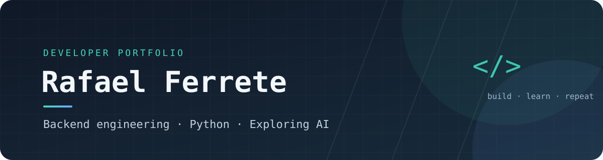

### Construindo, aprendendo e transformando ideias em código.

---

## 👨‍💻 Sobre mim

Sou estudante de **Desenvolvimento de Software Multiplataforma (DSM) na Fatec**. Tenho interesse em backend, engenharia de software e inteligência artificial.

Gosto de entender como as coisas funcionam por trás da interface: APIs, regras de negócio, bancos de dados e arquitetura. Aprendo principalmente colocando a mão no código e construindo projetos.

- 🔭 Desenvolvendo projetos com foco em backend.
- 🌱 Estudando fundamentos de Machine Learning, PLN e aplicações com LLMs.
- 🎯 Objetivo: evoluir como desenvolvedor e criar software útil, bem estruturado e confiável.

## 🧰 Tecnologias

**Linguagens e desenvolvimento**

**Banco de dados e ferramentas**

## 🚀 Projetos em destaque

### [Job Tracker API](https://github.com/Rafaelferrte/job-tracker-api)

API REST para organizar candidaturas a vagas de emprego e estágio.

- **Backend:** Python, FastAPI e SQLAlchemy assíncrono.
- **Dados:** PostgreSQL e Alembic.
- **Segurança:** autenticação JWT e hash de senhas.
- **Infraestrutura:** Docker Compose.
- **Recursos:** CRUD, filtros, histórico de status e dashboard de estatísticas.

## 📊 GitHub

## 📚 No momento

- Machine Learning e fundamentos de IA.
- Processamento de Linguagem Natural.
- Engenharia de aplicações com LLMs.
- Estruturas de dados e boas práticas de programação.

---

**Sempre aprendendo. Sempre construindo.**

Obrigado por visitar meu perfil! Fique à vontade para explorar meus repositórios.

